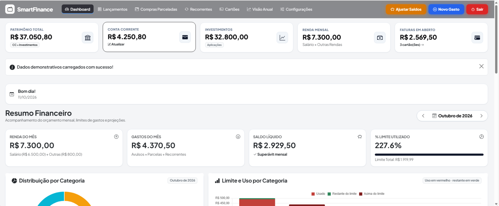
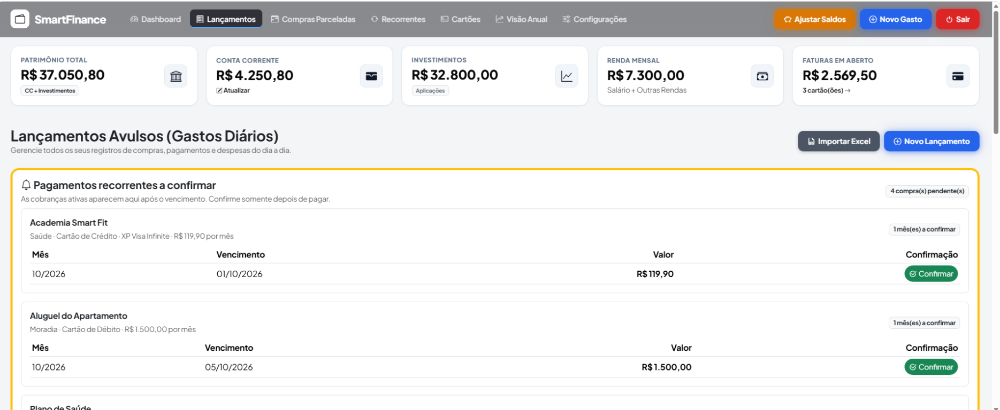
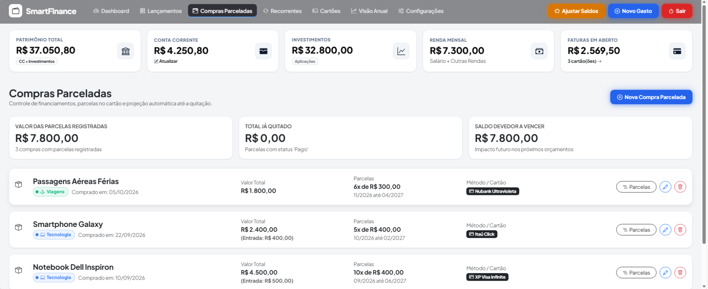
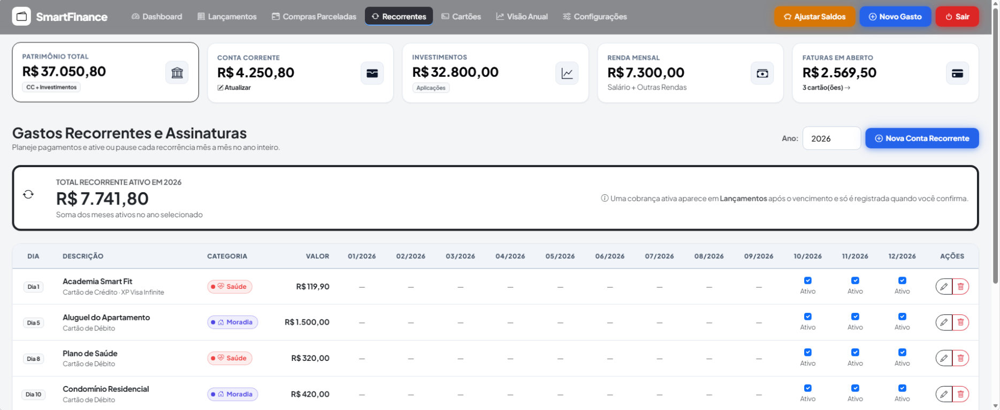
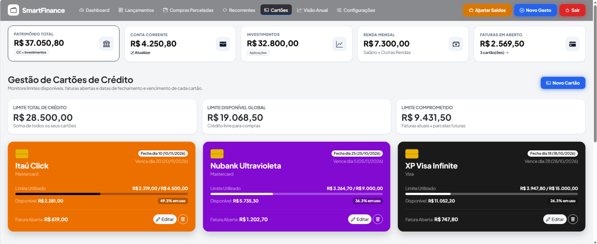
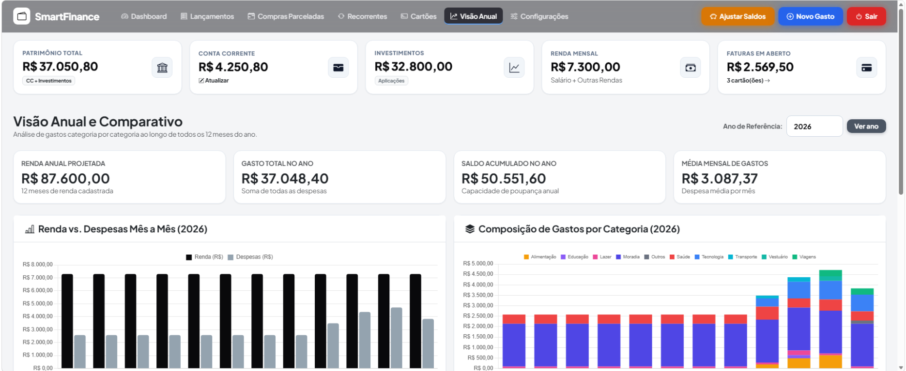

# SmartFinance

### Mais clareza para cuidar do seu dinheiro, no seu ritmo.

O SmartFinance é um aplicativo web de finanças pessoais para acompanhar gastos, cartões, parcelas e despesas recorrentes em um só lugar. Veja um resumo da sua vida financeira, registre movimentações e consulte seus gastos ao longo do ano — com os dados guardados localmente no seu computador.

> **Privacidade:** O SmartFinance não se conecta a bancos nem envia seus dados financeiros a serviços de nuvem. A interface carrega alguns recursos visuais por CDNs externos, mas não envia seus lançamentos a esses serviços.

## O que você pode fazer hoje

Explore as principais áreas do aplicativo nas capturas de tela:

| Visão geral | Lançamentos do dia a dia |
| --- | --- |
| **Dashboard** — acompanhe patrimônio, saldo, investimentos, renda, gastos e faturas em aberto. | **Lançamentos** — registre e filtre despesas; confirme pagamentos recorrentes vencidos. |
|  |  |
| Compras parceladas | Despesas recorrentes |
| **Planejamento de parcelas** — veja o total, o que já foi quitado e o saldo a vencer de cada compra. | **Recorrências** — organize cobranças por mês e acompanhe os pagamentos ativos ao longo do ano. |
|  |  |
| Cartões de crédito | Visão anual |
| **Cartões** — monitore limites disponíveis, valores comprometidos e faturas. | **Análise anual** — compare rendas e despesas mês a mês e veja a composição por categoria. |
|  |  |

Além dessas áreas, o SmartFinance permite importar compras do Excel com mapeamento de colunas e escolha do padrão decimal brasileiro (`1.234,56`) ou internacional (`1,234.56`), configurar rendas mês a mês, personalizar o formato de data e exportar ou importar backups JSON. Compras parceladas e recorrências podem ser editadas e acompanhadas sem perder os pagamentos já confirmados.

## O que vem pela frente

Estas são ideias para versões futuras; ainda não estão disponíveis no aplicativo. A ordem e o escopo podem mudar conforme o projeto evolui.

- [ ] **Open Finance:** estudar uma integração de leitura de transações com um provedor adequado, incluindo custos, consentimento, segurança e armazenamento dos tokens. A proposta é mostrar uma prévia para revisão antes de importar e permitir revogar a conexão.
- [ ] **Importar extratos CSV e OFX:** carregar arquivos exportados pelo banco, revisar as transações e identificar possíveis duplicatas antes de gravar.
- [ ] **Contas bancárias:** organizar várias contas e visualizar saldos consolidados.
- [ ] **Categorizar lançamentos com assistência:** sugerir categorias a partir das descrições, mantendo a possibilidade de revisar e corrigir as sugestões.
- [ ] **Tema escuro:** oferecer uma alternativa de aparência com preferência salva.
- [ ] **Mais idiomas:** ampliar o acesso com traduções para outros idiomas.
- [ ] **Acompanhar investimentos:** explorar uma área para organizar investimentos e acompanhar sua evolução.

O SmartFinance ainda **não oferece conexão bancária automática**. A importação de planilhas Excel cria lançamentos locais após o mapeamento e a validação das colunas. A ideia para Open Finance é consultar transações somente após autorização da pessoa usuária — não realizar pagamentos. Uma integração desse tipo exigirá escolher um provedor e explicar com clareza quais dados são compartilhados e como são protegidos.

## Como funciona

O aplicativo é executado localmente e abre automaticamente sua interface no navegador ao ser iniciado pelo atalho ou pelo executável. Ele usa Python e Flask na aplicação, SQLite para guardar os dados localmente e Waitress como servidor web. A interface usa HTML, CSS e JavaScript.

O arquivo do banco de dados fica em `Recursos/Dados/finance.db`. Faça backups regularmente e não compartilhe esse arquivo: ele pode conter informações financeiras pessoais. A exportação JSON está disponível em **Configurações**.

### Requisitos

- Windows
- Conexão com a internet para carregar recursos visuais externos

### Executável e instalador para Windows

Baixe e execute `SmartFinance-Setup.exe` para instalar o SmartFinance. Depois, inicie pelo atalho escolhido ou pelo executável instalado. O instalador oferece dois modos:

- **Instalado:** instala o aplicativo em `%LOCALAPPDATA%\Programs\SmartFinance` e guarda o banco em `%LOCALAPPDATA%\SmartFinance\finance.db`. Durante a instalação, escolha se deseja atalhos no menu Iniciar, na área de trabalho, em ambos ou em nenhum. O atalho abre o aplicativo no navegador. Desinstalar o programa preserva o banco.
- **Portátil:** instala os arquivos em uma pasta escolhida, sem atalhos nem entrada de desinstalação. Para iniciar, execute `SmartFinance.exe` nessa pasta. O banco fica em `Dados\finance.db` nessa mesma pasta; mova a pasta inteira para levar o aplicativo e os dados juntos.

Ao executar novamente o instalador, ele detecta a instalação local registrada e oferece atualizar os arquivos sem alterar o banco nem os atalhos. Para atualizar uma versão portátil, escolha essa opção e selecione a pasta existente; o instalador valida o marcador portátil e mantém `Dados`. Feche o aplicativo antes de atualizar. Para uma instalação nova, a migração dos dados antigos continua disponível quando o arquivo de origem é encontrado; um banco que já exista no destino nunca é sobrescrito.

Durante a instalação, pode-se informar a localização de um banco existente. O aplicativo o copia apenas se ainda não houver um banco no destino, verifica a integridade da cópia e mantém o arquivo original. Sem um caminho informado, também procura os dados da outra modalidade, `Documents\SmartFinance\Recursos\Dados\finance.db`, a pasta `Recursos\Dados` ao lado do executável e a pasta equivalente em OneDrive. Para indicar outro caminho antes de iniciar o aplicativo, defina `SMARTFINANCE_LEGACY_DB` com o caminho completo do arquivo antigo.

O executável inclui Python e as dependências; quem o utiliza não precisa instalar Python. Para gerar a distribuição a partir do código, em um computador Windows com Python 3.15 e NSIS instalados, execute na raiz:

```powershell
py -3.15 -m pip install --upgrade -r Recursos\Dependencias\requirements-build.txt
powershell.exe -NoProfile -ExecutionPolicy Bypass -File .\scripts\build_windows.ps1
```

O script roda os testes usando bancos temporários, empacota o aplicativo e cria `dist\SmartFinance-Setup.exe`. O uso de `-ExecutionPolicy Bypass` vale somente para esse processo e não altera a política do PowerShell no computador. A configuração de imports adiados segue o mecanismo oficial `__lazy_modules__`: Python 3.15 adia os módulos selecionados até o primeiro uso; versões anteriores continuam importando-os normalmente.

Se o aplicativo já foi empacotado em `dist\SmartFinance`, o instalador NSIS também pode ser recompilado diretamente, sem parâmetros adicionais:

```powershell
Push-Location .\installer
try { makensis .\SmartFinance.nsi } finally { Pop-Location }
```

### Backups JSON

Em **Configurações**, use **Exportar JSON (Backup)** para baixar uma cópia e **Importar backup JSON** para mesclar uma cópia existente. A importação mostra uma prévia: adiciona registros novos, ignora os que já são iguais e lançamentos duplicados, e pede uma escolha para cada conflito entre os dados atuais e o backup. Nenhuma alteração é gravada até a confirmação; a mesclagem é transacional, então uma falha cancela o lote inteiro. Faça um backup antes de importar.

### Encerrar

Use o botão **Sair** na barra superior e escolha uma das opções apresentadas:

- **Salvar e Sair** para salvar os dados e encerrar o aplicativo.
- **Sair sem Salvar** para encerrar sem persistir as alterações pendentes.

## Executar os testes

Para desenvolvimento, com Python e as dependências do projeto instalados, execute na raiz:

```powershell
py -m unittest discover -s Recursos\Testes -t . -p test_app.py
```

## Estrutura do projeto

```text
SmartFinance/
├── README.md
├── Recursos/
│   ├── Codigo/          # Aplicação Flask, modelos e acesso ao banco
│   ├── Interface/       # Templates, CSS e JavaScript
│   ├── Dependencias/    # Dependências Python
│   ├── Testes/          # Testes automatizados
│   └── Dados/           # Banco SQLite local
└── .gitignore
```

## Ideias, problemas e contribuições

Encontrou um problema ou tem uma sugestão? Abra uma issue neste repositório descrevendo o que aconteceu ou como a ideia ajudaria. Contribuições são bem-vindas; para mudanças maiores, uma issue antes do pull request ajuda a alinhar a solução.

Ao reportar um problema, não anexe extratos, credenciais, backups ou outros dados financeiros reais. Se precisar demonstrar um caso, use informações fictícias.
